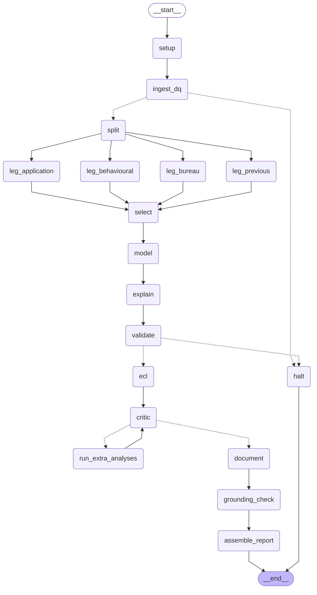
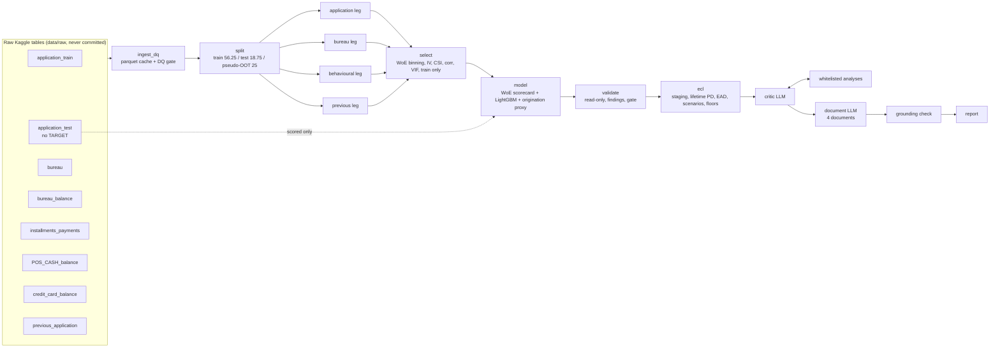

# agentic-credit-risk-pd-ecl

**An agent-orchestrated credit risk pipeline:** a probability-of-default (PD) scorecard on the public Home Credit Default Risk data, independently validated, extended to an illustrative RBI expected credit loss (ECL) calculation, and documented by LLM agents whose every number is machine-checked.

A [LangGraph](https://github.com/langchain-ai/langgraph) state machine runs 17 nodes. Four "leg" agents build 114 documented features in parallel from seven tables. A WoE logistic regression scorecard (champion) and a depth-limited LightGBM model (challenger) are fitted on train only. A read-only validator applies Gini, KS, PSI, calibration and segment tests and raises findings with severities; red findings halt the run. Surviving models feed a staged, scenario-weighted ECL simulation under the RBI Directions RBI/DOR/2026-27/398. An LLM critic then challenges the results, and may only request whitelisted deterministic analyses. A documentation agent drafts a Model Development Document, Independent Validation Report, Ongoing Monitoring Plan and ECL Methodology Note. Finally, a grounding check verifies every number in those documents against the run's own results.

> ### Core design principle
> **LLM agents never fit, tune or alter the model.** The modelling core is deterministic and reproducible: fixed seed, versioned YAML config, and the same inputs give the same numbers (enforced by tests and artefact checksums). LLM agents sit *around* that core to critique and document, mirroring first-line development versus second-line independent validation. In this repo an "agent" is a graph node with a declared contract; only two nodes (`critic` and `document`) call an LLM.

Public data only. This is a portfolio project, not a production model and not anyone's provisioning methodology.

---

## Contents
[The graph](#the-graph) · [Execution order](#execution-order-node-by-node) · [Data flow](#data-flow) · [Typed state](#the-typed-state-in-plain-english) · [Fan-out and join](#parallel-fan-out-and-join-the-four-legs) · [Critic loop](#the-critic-loop) · [Controls](#model-risk-controls) · [Results](#results) · [Findings](#validation-findings) · [Regulatory mapping](#regulatory-mapping) · [How to run](#how-to-run) · [Cost](#cost) · [Limitations](#limitations) · [Project structure](#project-structure) · [About the author](#about-the-author)

---

## The graph

Generated from the compiled LangGraph (`acr graph`), not drawn by hand. Dotted arrows are conditional edges: the data-quality gate, the validation gate and the bounded critic loop.

<!-- BEGIN:graph -->

<!-- END:graph -->

## Execution order, node by node

Every node is wrapped by a `@node(reads=..., writes=...)` contract (`src/acr/audit.py`). A node receives a **read-only view containing only the keys it declared**; returning an undeclared key raises `ContractViolation`; start, end, inputs, outputs, gate decisions and timings go to `outputs/<run_id>/audit.jsonl`. This table is generated from those declarations, so it cannot drift from the code.

<!-- BEGIN:nodes -->
| # | Node | What it does | Reads | Writes | LLM | On failure |
|---|---|---|---|---|---|---|
| 0 | `setup` | Validate config, create run_id and run folder, snapshot config, start the audit trail. | `config`, `sample_frac`, `llm_mode` | `run_id`, `run_dir`, `config_hash`, `critic_iteration`, `critic_requests`, `halted` | no | Invalid config raises a pydantic ValidationError before any data is touched. |
| 1 | `ingest_dq` | Load raw tables into a downcast parquet cache; run schema, key, duplicate, missingness and target-rate checks. | `config`, `sample_frac` | `dq`, `gate_log` | no | Any failed critical check sets dq.status='halt'; the gate routes to the halt node. |
| 2 | `split` | Optional stratified customer sample, then stratified 75:25 (dev:OOT) and 75:25 (train:test) split on SK_ID_CURR; persist ID lists. | `config`, `sample_frac`, `dq` | `split` | no | Exception propagates; run stops and the audit trail records the error. |
| 3 | `leg_application` | Applicant and loan attributes at application. Aggregates application_train to SK_ID_CURR; leg-level quality checks; writes a feature table and feature dictionary. | `config`, `split`, `dq` | `legs` | no | A critical leg quality failure (e.g. duplicate IDs) raises and stops the run. |
| 4 | `leg_bureau` | Credit with other lenders and monthly bureau DPD history. Aggregates bureau, bureau_balance to SK_ID_CURR; leg-level quality checks; writes a feature table and feature dictionary. | `config`, `split`, `dq` | `legs` | no | A critical leg quality failure (e.g. duplicate IDs) raises and stops the run. |
| 5 | `leg_behavioural` | Repayment behaviour on prior Home Credit loans. Aggregates installments_payments, POS_CASH_balance, credit_card_balance to SK_ID_CURR; leg-level quality checks; writes a feature table and feature dictionary. | `config`, `split`, `dq` | `legs` | no | A critical leg quality failure (e.g. duplicate IDs) raises and stops the run. |
| 6 | `leg_previous` | Earlier applications to Home Credit. Aggregates previous_application to SK_ID_CURR; leg-level quality checks; writes a feature table and feature dictionary. | `config`, `split`, `dq` | `legs` | no | A critical leg quality failure (e.g. duplicate IDs) raises and stops the run. |
| 7 | `select` | Join the four legs; select scorecard features on train only by missingness, IV, train-vs-test CSI, correlation, VIF, a size cap and coefficient sign/significance; log every exclusion with a reason. | `config`, `split`, `legs` | `selection` | no | Exception propagates; run stops and the audit trail records the error. |
| 8 | `model` | Fit the champion WoE logistic scorecard and LightGBM challenger on train; decide calibration from out-of-fold train predictions; map PD to the master scale; fit the application-only origination-proxy scorecard for ECL staging. | `config`, `split`, `selection` | `model` | no | Exception propagates; run stops and the audit trail records the error. |
| 9 | `explain` | Exact TreeSHAP explanations of the LightGBM challenger: global and per-leg importance, top-4 reason codes for every OOT applicant, stability of the top drivers, and a direct test that the monotonic constraints hold. Reads the saved model; never refits. | `config`, `split`, `selection`, `model` | `explain` | no | Exception propagates; run stops and the audit trail records the error. |
| 10 | `validate` | Independent second-line validation over scored outputs: Gini/AUC/KS by partition, score PSI and feature CSI, calibration (HL, ECE, slope, grade-level binomial tests), rank-ordering, segments, champion vs challenger with bootstrap CI; structured findings; performance and stability gates. Read-only: artefact checksums verified before and after. | `config`, `sample_frac`, `split`, `model`, `selection`, `explain` | `validation`, `gate_log` | no | A red finding with gate enforcement on routes to the halt node with a halt report. |
| 11 | `ecl` | Illustrative RBI ECL on the OOT book: stage allocation with audited triggers, 12-month and lifetime PD (constant hazard and bureau DPD Markov chain), amortising EAD, EIR discounting, weighted macro scenarios, LGD backstop and sensitivity, RBI stage floors. | `config`, `split`, `dq`, `selection`, `model` | `ecl` | no | Exception propagates; run stops and the audit trail records the error. |
| 12 | `critic` | LLM second-line challenger: reviews validation and ECL summaries, may request whitelisted deterministic analyses. Cannot change the model. | `config`, `config_hash`, `sample_frac`, `dq`, `split`, `selection`, `model`, `explain`, `validation`, `ecl`, `extra_analyses`, `critic_iteration` | `critic_reviews`, `critic_requests`, `critic_iteration`, `llm_calls` | yes | If no LLM is available the node records a skip and the pipeline continues. |
| 13 | `run_extra_analyses` | Run the critic's whitelisted, deterministic analysis requests over saved outputs; never touches model artefacts. | `config`, `critic_requests`, `critic_iteration`, `model`, `ecl`, `selection` | `extra_analyses`, `critic_requests` | no | Exception propagates; run stops and the audit trail records the error. |
| 14 | `document` | Draft the Model Development Document, Independent Validation Report, Ongoing Monitoring Plan and ECL Methodology Note section by section: LLM prose from curated facts, tables rendered by code. | `config`, `config_hash`, `sample_frac`, `dq`, `split`, `selection`, `model`, `explain`, `validation`, `ecl`, `critic_reviews`, `extra_analyses` | `documents`, `llm_calls` | yes | If no LLM is available the node records a skip and the pipeline continues. |
| 15 | `grounding_check` | Extract every number from the generated documents and verify it against the run's facts, extra analyses and config within rounding; flag anything unverified. | `config`, `config_hash`, `sample_frac`, `dq`, `split`, `selection`, `model`, `explain`, `validation`, `ecl`, `documents`, `extra_analyses` | `grounding` | no | Exception propagates; run stops and the audit trail records the error. |
| 16 | `assemble_report` | Write run_summary.json and print a console summary. | `run_id`, `config_hash`, `sample_frac`, `llm_mode`, `dq`, `split`, `legs`, `selection`, `model`, `explain`, `validation`, `ecl`, `critic_reviews`, `extra_analyses`, `documents`, `grounding`, `gate_log`, `llm_calls` | `report` | no | Exception propagates; run stops and the audit trail records the error. |
| 17 | `halt` | Stop the run after a red gate; write halt_report.md explaining why, and run_summary.json with everything computed before the halt. | `run_id`, `config_hash`, `sample_frac`, `llm_mode`, `dq`, `split`, `legs`, `selection`, `model`, `explain`, `validation`, `ecl`, `critic_reviews`, `extra_analyses`, `documents`, `grounding`, `gate_log`, `llm_calls` | `halted`, `halt_reason`, `report` | no | Exception propagates; run stops and the audit trail records the error. |
<!-- END:nodes -->

**Gates.** After `ingest_dq`, any failed critical check (missing table or column, duplicate IDs, non-binary target) routes to `halt`. After `validate`, any red finding routes to `halt` on full runs and only warns on `--sample` runs. Red findings are a champion test or OOT Gini below 0.45, score PSI at or above 0.25, or a model-artefact checksum mismatch. `halt` writes `halt_report.md` with the red findings, plus `run_summary.json`.

## Data flow



## The typed state, in plain English

`PipelineState` (`src/acr/state.py`) is one typed dictionary that flows through the graph. It holds **paths to saved tables, metrics, findings and audit metadata, never DataFrames**. That keeps it auditable, and it means anything handed to an LLM is a summary by construction.

| Key | What it holds | Written by |
|---|---|---|
| `run_id`, `run_dir`, `config`, `config_hash` | identity of the run and the exact validated settings | `setup` |
| `dq` | every data-quality check with its severity, table sizes, target rate, pass/halt | `ingest_dq` |
| `split` | partition counts, proportions and default rates, assignment hash, ID-list paths, the unlabelled external population | `split` |
| `legs` | per leg: feature table path, feature dictionary path, leg-level quality checks (merged from four parallel writers) | four `leg_*` nodes |
| `selection` | candidates, screens, selected features with IV/CSI/VIF, every exclusion with a reason | `select` |
| `model` | champion and challenger summaries, calibration decision, artefact paths and **SHA-256 checksums** | `model` |
| `validation` | metrics by partition, calibration, stability, segments, benchmarking, structured findings, gate decision | `validate` |
| `ecl` | staging counts and triggers, ECL by stage, scenario, method and LGD, QC checks | `ecl` |
| `critic_iteration`, `critic_requests`, `critic_reviews`, `extra_analyses` | the bounded critic loop: its challenges, its requests and their deterministic results | `critic`, `run_extra_analyses` |
| `documents`, `grounding` | paths to the four documents; numbers verified, allowlisted and unverified | `document`, `grounding_check` |
| `llm_calls`, `gate_log` | tokens and cost per LLM call; every gate decision | append-only across nodes |

## Parallel fan-out and join: the four legs

`split` has a static edge to each of `leg_application`, `leg_bureau`, `leg_behavioural` and `leg_previous`. LangGraph runs them in the same super-step, concurrently (bounded by `runtime.max_concurrency: 2` to keep the full run under about 4 GB on an 8 GB laptop). Each leg writes only its own entry under `legs`; the `merge_dicts` reducer combines them and **raises if two branches write the same key**. `select` is registered with `add_edge([four legs], "select")`, so it waits for all four.

Legs are per-customer aggregations of that customer's own records and **never receive TARGET**. Tests check that leg code never references it, that features are identical when targets are shuffled, and that a customer's features don't depend on who else is in the run. Gender and marital status are tagged `segment_only`: they're used for fairness analysis, never offered to a model.

## The critic loop

After ECL, the `critic` node acts as a skeptical second-line validator. It receives only the curated **facts** summary (`src/acr/core/facts.py`): no loan-level rows, guarded by `assert_summary_only`, which rejects ID keys, long lists and oversized payloads. It returns JSON with challenges and requests.

* **Whitelisted requests only.** A request must be one of five deterministic analyses, validated by a pydantic `Literal`: `segment_cut`, `lgd_sensitivity`, `binning_stability_alt`, `grade_concentration`, `pd_floor_impact`. Each takes small validated parameters. Anything else (for example "retune the model") is rejected and logged.
* **Bounded.** `run_extra_analyses` runs the requests and the critic re-reviews them, for at most **2 rounds** (`max_critic_iterations`, validated ≤ 2). Requests after the bound are dropped and logged. A loop that an LLM can extend indefinitely isn't a control.
* **Can't touch the model.** The critic's output schema has no field that refers to model parameters. The analyses read saved outputs only. The model's artefacts are checksummed, and the critic runs *after* validation anyway.

## Model-risk controls

| Control | Where | What it guarantees |
|---|---|---|
| **Grounding check** | `core/grounding.py`, `nodes/grounding.py` | Every number in every generated document is matched to the run's facts, analysis results or config within its displayed rounding (percentages and millions included). Anything else is listed as unverified, with context. Numbers the LLMs wrote themselves are *not* a valid source. Structural numbers (years, SR 11-7, paragraph references) are allowlisted. |
| Tables by code, prose by LLM | `core/docs.py` | Every table in the documents is rendered from facts by code; the LLM writes narrative only. |
| Train-only fitting | `core/guards.py` | Every fitter calls `require_partition(..., "train")`. Tests shuffle test and OOT targets and confirm that bins, selection, coefficients and PDs are unchanged. |
| Read-only independent validator | `nodes/validate.py` | Imports no fitting code (tested by source inspection). It verifies each model artefact's SHA-256 before and after it runs; tampering is a red finding that halts the run (tested). |
| Reproducibility | config hash in every `run_id` | Same seed and config give identical scores and artefact checksums (tested). |
| Audit trail | `outputs/<run_id>/audit.jsonl` | Every node start, end, error, route, gate, critic request and analysis. |
| Hard limits in the schema | `config.py` | ≤ 15 scorecard variables; LightGBM `max_depth` 1–10; critic rounds ≤ 2; scenario weights sum to 1. |
| Offline, train-only tuning | `acr tune`, `tuning.py` | Hyperparameters chosen by 3-fold CV inside train with a one-standard-error rule, then frozen into config by a human (decision D22). |

## Results

All numbers below are filled in by `scripts/fill_readme.py` from a single run's `run_summary.json`.

<!-- BEGIN:results -->
From run `20261019T052034Z_full_975e6130602a` (full population, dry-run LLM mode, config hash `975e6130602a`).

**Discrimination and calibration** (Gini = 2 × AUC − 1)

| Model | Partition | Gini | AUC | KS | Mean PD | Default rate |
|---|---|---|---|---|---|---|
| champion | train | 0.5041 | 0.7521 | 0.3782 | 8.07% | 8.07% |
| champion | test | 0.4896 | 0.7448 | 0.3676 | 8.06% | 8.07% |
| champion | oot | 0.5008 | 0.7504 | 0.3769 | 8.04% | 8.07% |
| challenger | train | 0.6120 | 0.8060 | 0.4623 | 8.07% | 8.07% |
| challenger | test | 0.5520 | 0.7760 | 0.4115 | 8.07% | 8.07% |
| challenger | oot | 0.5602 | 0.7801 | 0.4263 | 8.08% | 8.07% |

| Measure | Value |
|---|---|
| Champion OOT decile ECE / calibration slope | 0.0023 / 1.003 |
| Challenger − champion OOT Gini (95% bootstrap CI) | 0.0594 (0.0524 to 0.0649) |
| Score PSI train→test / train→OOT | 0.0001 / 0.0001 |
| Largest selected-feature CSI | 0.0850 |
| Stress PSI ladder (under-30s ×3 / ×10 / ×50) | 0.0206 / 0.1319 / 0.3391 |
| Score PSI, unlabelled application_test (48,744) vs train | 0.0018 |

**Illustrative RBI ECL** on the OOT book (76,878 loans; LGD 70%; floors 1% / 5% / 25%)

| Stage | Accounts | Exposure (m) | Final ECL (m) | Coverage | Realised default rate |
|---|---|---|---|---|---|
| stage 1 | 74,397 | 44,526.4 | 1,827.3 | 4.10% | 7.90% |
| stage 2 | 2,410 | 1,440.7 | 206.4 | 14.32% | 12.99% |
| stage 3 | 71 | 36.8 | 25.8 | 70.00% | 23.94% |
| total | 76,878 | 46,003.9 | 2,059.5 | 4.48% | 8.07% |

| Control | Result |
|---|---|
| Validation gate | continue (0 red, 0 high, 5 medium, 7 low, 3 info) |
| Critic loop | 2 reviews, 3 whitelisted analyses run |
| Grounding check | pass: 518 numbers verified, 0 unverified |
| LLM calls (dry-run) | 30 calls, ~156,446 input tokens |
| ECL QC checks | 5 of 5 pass |
<!-- END:results -->

**Reading the results.**
* *Discrimination.* The champion's OOT AUC of about 0.75 is typical for a 13-variable monotonic scorecard on this data. The challenger's about 0.79 is on a par with well-known public LightGBM kernels, which report about 0.79 as an out-of-fold CV figure; ours is on a holdout the model never saw.
* *Calibration* is close at portfolio and grade level, and neither model needed recalibration.
* *Stability.* PSI is near zero **by construction**, because the OOT is a random holdout. The stress ladder shows how large a mix shift the metric needs before it reacts.
* *External scores.* Without EXT_SOURCE_1/2/3 the champion falls below the gate. See [the sensitivity analysis](docs/sensitivity_ext_source.md).

New to the code? [notebooks/credit_risk_explained.ipynb](notebooks/credit_risk_explained.ipynb) rebuilds every step in plain Python (data, split, features, WoE, scorecard, LightGBM, validation and one loan's ECL by hand), checking each number against the pipeline. It is committed without outputs; run it locally after `acr run`.

Sample generated documents from this run: [Model Development Document](docs/sample_outputs/model_development.md) · [Independent Validation Report](docs/sample_outputs/independent_validation.md) · [Ongoing Monitoring Plan](docs/sample_outputs/ongoing_monitoring.md) · [ECL Methodology Note](docs/sample_outputs/ecl_methodology.md) · [Grounding report](docs/sample_outputs/grounding_report.md)

## Validation findings

Generated by deterministic rules, with the thresholds stated in each finding. The full details and remediation are in the [validation report](docs/sample_outputs/independent_validation.md).

<!-- BEGIN:findings -->
| ID | Severity | Area | Finding |
|---|---|---|---|
| V01 | medium | Performance | Champion test Gini close to gate |
| V02 | medium | Benchmarking | Challenger materially outperforms champion |
| V03 | medium | Stability | Stability testing is not temporal (pseudo-OOT) |
| V04 | info | Stability | External population (application_test) score distribution stable |
| V05 | low | Calibration | Amber calibration in some grades (OOT) |
| V06 | low | Master scale | Sparsely populated grades |
| V07 | low | Segments | Segment calibration off in contract_type = Revolving loans |
| V08 | low | Segments | Segment calibration off in income_type = Commercial associate |
| V09 | low | Segments | Segment calibration off in income_type = Pensioner |
| V10 | low | Segments | Segment calibration off in income_type = State servant |
| V11 | low | Segments | Segment calibration off in age_band = <30 |
| V12 | medium | Conceptual soundness | Heavy reliance on undisclosed external scores |
| V13 | info | Explainability | Monotonic constraints verified |
| V14 | info | Explainability | Challenger explanations are stable |
| V15 | medium | Conceptual soundness | Target is not the regulatory default definition |
<!-- END:findings -->

## Regulatory mapping

| Component | SR 11-7 (Fed/OCC model risk guidance) | RBI |
|---|---|---|
| DQ checks and gate; feature dictionary | Development: data quality, relevance and documentation | Draft MRM guidance (June 2026, **draft**): data governance |
| Train-only fitting, leakage tests, reproducibility | Sound development, implementation and testing | Draft MRM guidance: development standards |
| Champion vs challenger with bootstrap CI | Outcomes analysis and benchmarking | Draft MRM guidance: validation |
| Read-only validator, findings with severity and remediation | Independent validation; effective challenge | ECL Directions model-risk requirements†; draft MRM guidance: independent validation |
| Gates and halt | Limits on model use; conservatism | |
| Ongoing Monitoring Plan (PSI/CSI, Gini, binomial tests; triggers and escalation) | Ongoing monitoring | ECL Directions model-risk requirements† |
| Critic agent with whitelisted analyses | Effective challenge | |
| Audit trail, config hash, decisions log | Governance, policies and documentation | Draft MRM guidance: model inventory and documentation |
| Stage 1/2/3 definitions; borrower-level credit impairment | | ECL Directions para 25 |
| SICR against initial recognition (origination-proxy grade/PD test) | | para 26 |
| 30 DPD rebuttable presumption | | para 33 (rebuttal not routine: para 34) |
| Lifetime horizon = contractual term; revolving life set by the bank | | para 46 |
| Multiple probability-weighted macro scenarios | | para 48 |
| Discounting at the EIR | | para 50 |
| Stage-wise minimum provisions, unsecured retail 1% / 5% / 25%→100% | | para 82(3)(x) |
| 12-month PD floor 0.03% | | para 96 |
| LGD backstop 70% unsecured | | para 97 |

Paragraph references are to the Reserve Bank of India (Commercial Banks – Asset Classification, Provisioning and Income Recognition) Directions, 2026, RBI/DOR/2026-27/398, dated 27 April 2026 and effective 1 April 2027. They were checked against the primary text on rbi.org.in on 18 October 2026. † The Directions' model-risk chapter is referenced from published summaries; check it against the full text before relying on it. The RBI Guidance on Regulatory Principles for Model Risk Management, 2026 was issued in **draft** on 24 June 2026 and was not final at the time of writing.

## How to run

```bash
git clone https://github.com/pranayvasa/agentic-credit-risk-pd-ecl.git
cd agentic-credit-risk-pd-ecl
python3 -m venv .venv
.venv/bin/pip install -e ".[dev]"
```

**Data.** Download the [Home Credit Default Risk](https://www.kaggle.com/c/home-credit-default-risk/data) files into `data/raw/` (step-by-step instructions in [docs/DATA.md](docs/DATA.md)). The first run builds a downcast parquet cache in `data/interim/` (about 20 s).

```bash
.venv/bin/acr run --sample          # 10% stratified sample, dry-run LLM, about 40 s
.venv/bin/acr run                   # full population, dry-run LLM, about 2.5 min, peak about 4 GB
.venv/bin/acr estimate-cost         # price a Gemini run from the last dry run's real prompts (no API calls)
cp .env.example .env                # then set GEMINI_API_KEY in .env (gitignored)
.venv/bin/acr run --llm gemini      # test model (gemini-3.5-flash-lite)
.venv/bin/acr run --llm gemini --gemini-model final   # final model (gemini-3.6-flash)
.venv/bin/acr run --llm ollama      # local model (llama3.1:8b by default; no cost)
.venv/bin/acr tune                  # offline train-only CV tuning report (about 35 min)
.venv/bin/acr run --exclude-features APP_EXT_SOURCE_1,APP_EXT_SOURCE_2   # sensitivity runs
.venv/bin/acr graph                 # regenerate docs/graph.mmd
.venv/bin/pytest                    # 147 tests on a synthetic dataset (no Kaggle data needed)
```

**Dry-run is the default.** With no key and no local model, the deterministic pipeline completes and the LLM nodes record a clear skip. Prompts are versioned files under `prompts/`. Outputs go to `outputs/<run_id>/`: `audit.jsonl`, `run_summary.json`, `artefacts/`, `documents/`, and on full runs `kaggle/` (submission files for both models).

## Cost

Every LLM call records its input and output tokens and its cost at the rates in `config/llm.yaml`, and the run prints a total. A full run makes 29 LLM calls (2 critic reviews and 27 document sections; the critic can take at most 3). `acr estimate-cost` prices that from a dry run's actual prompts: about **$0.08** with gemini-3.5-flash-lite or **$0.15** with gemini-3.6-flash (±30%; rates as at October 2026, and 3.6 Flash's rates double from 1 January 2027). Dry-run and Ollama cost nothing.

## Limitations

* **Pseudo-OOT.** Home Credit has no application dates, so the 25% "out-of-time" holdout is a random stratified holdout. It cannot evidence temporal stability, and PSI/CSI are near zero by construction. A true out-of-time sample would be needed before any real use.
* **Target definition.** TARGET flags payment difficulties on early instalments, not 90+ DPD within 12 months (the NPA definition). PDs are used as 12-month-equivalent proxies.
* **External scores.** EXT_SOURCE_1/2/3 come from an undisclosed source, yet they carry about half the scorecard's points range. Without them the champion fails the gate ([sensitivity](docs/sensitivity_ext_source.md)).
* **Illustrative ECL.** The book is the OOT holdout at a simulated reporting date with every loan at origination. Staging uses prior-loan delinquency and an application-only origination proxy, because no origination-date PD exists. Term and EIR are derived from rates implied by prior loans (segment-level, not loan-level). LGD is the regulatory backstop, not an estimate. Scenarios are illustrative. The figures demonstrate the method; they are not a provision.
* **Model scope.** A deliberately lean scorecard (≤ 15 variables) on 114 curated features; no brute-force aggregation or ensembling.

## Project structure

```
config/          base.yaml (data, split, features, model) · gates.yaml · llm.yaml · ecl_rbi.yaml · tuning.yaml
prompts/         critic_v1.md · doc_section_v1.md · doc_sections_v1.yaml (document spec)
src/acr/
  graph.py       LangGraph wiring, gates and the bounded critic loop
  state.py       typed PipelineState, findings and critic request schemas
  audit.py       @node contract and JSONL audit trail
  config.py      pydantic config schemas and hard limits
  cli.py         acr run | tune | estimate-cost | graph | nodes
  nodes/         one module per graph node (legs/ holds the four leg agents)
  core/          deterministic logic: io, dq, split, legs/, binning, selection, scorecard,
                 challenger, calibration, master_scale, metrics, validation, findings,
                 ecl/ (rates, staging, lifetime, engine), facts, extras, docs, grounding
  llm/           dry-run, Gemini and Ollama providers; token cost
  tuning.py      offline train-only CV tuning
tests/           147 tests on a synthetic Home Credit-shaped dataset
docs/            PROJECT_BRIEF · DECISIONS (D1–D31) · DATA · sensitivity_ext_source · graph.mmd · sample_outputs/
notebooks/       credit_risk_explained.ipynb (beginner, plain-Python rebuild of every step, checked against the pipeline)
                 pipeline_walkthrough.ipynb (source-code walkthrough)
scripts/         fill_readme.py · build_explained.py · build_walkthrough.py
```

Every design choice that refines or departs from the original brief is recorded with its reason in [docs/DECISIONS.md](docs/DECISIONS.md).

## About the author

**Pranay Vasa**: Chartered Accountant with seven years in BFSI credit risk and analytics, including multi-leg PD model development (application, behavioural, bureau and transaction data). This repository uses public data only; it contains no employer data, code or methodology.

[GitHub](https://github.com/pranayvasa) · [LinkedIn](https://www.linkedin.com/in/LINKEDIN_HANDLE)

## Licence

MIT. See [LICENSE](LICENSE). The Home Credit data is subject to Kaggle's competition rules and is not redistributed here.
